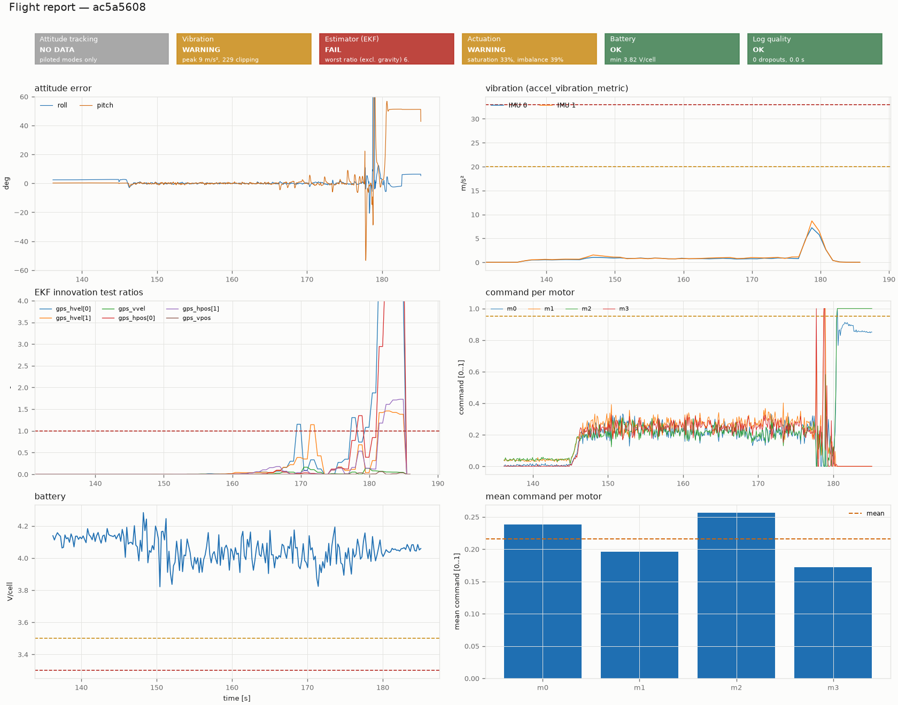
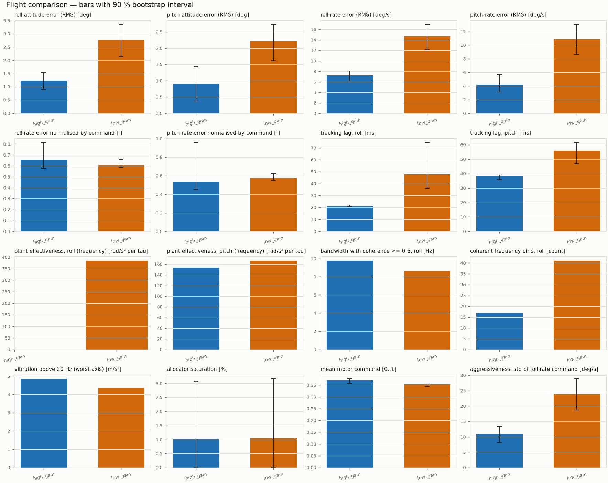
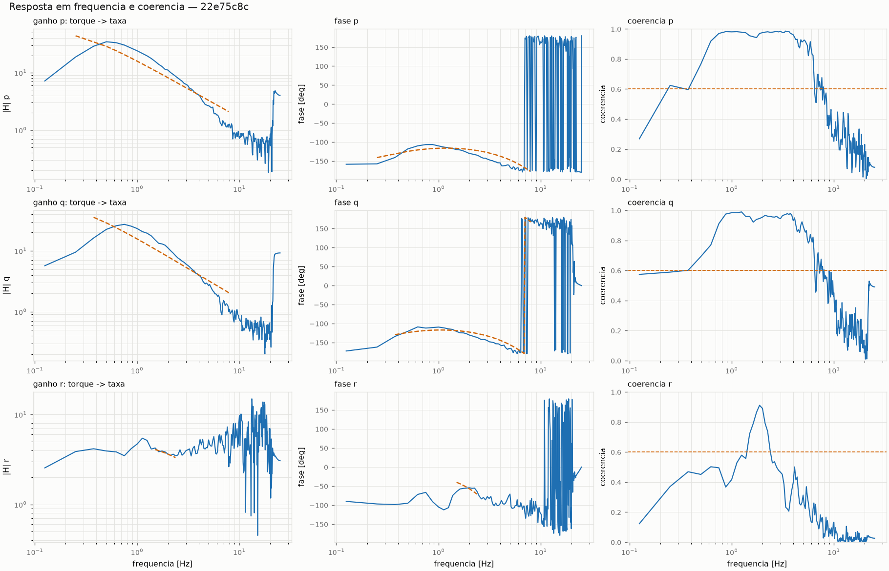
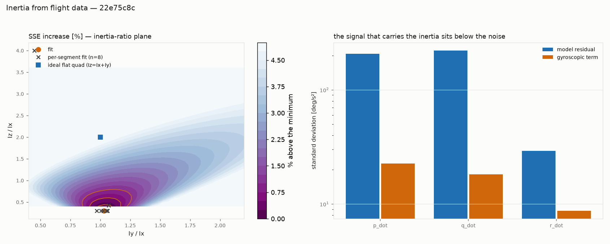

# px4-flight-analysis

Turning PX4 flight logs into engineering answers instead of more plots.

Flight Review shows you what happened. This toolkit tries to answer three questions a
flight-test engineer actually asks:

1. **Is this flight healthy?** A per-flight report with a verdict per area, thresholds
   calibrated against 209 public flights, and each metric placed in that distribution.
2. **Did my change help?** A flight-to-flight comparison with a PX4 parameter diff,
   confidence intervals from a block bootstrap, and an explicit split between metrics
   that survive a change of flying conditions and metrics that do not.
3. **What is this vehicle's dynamics?** Sparse and frequency-domain identification of
   the attitude-rate plant — including an honest answer about what the data *cannot*
   tell you.

Everything here runs on public logs from [PX4 Flight Review](https://review.px4.io).
No private data was used.

---

## Quick start

```bash
python3 -m venv .venv && .venv/bin/pip install -r requirements.txt
source .venv/bin/activate

# pick public logs from the 493,010-flight index
curl -sSL https://review.px4.io/dbinfo | gunzip > dbinfo.json
python src/select_logs.py dbinfo.json

# download one and look at it
mkdir -p data/ulg/<log_id> && curl -sSL -o data/ulg/<log_id>/<log_id>.ulg \
  https://cdn.logs.px4.io/<log_id>.ulg

python src/flight_report.py data/ulg/<log_id>/<log_id>.ulg
```

Run every script from the repository root; they read `data/` and write to `out/`.

---

## The tools

| script | question it answers |
|---|---|
| `flight_report.py` | Is this flight healthy? Verdict per area + position in the public fleet |
| `compare_flights.py` | Did my change help? Parameter diff + metrics with confidence intervals |
| `freq_id.py` | Where is this log informative, and what structure describes the plant? |
| `sindy_rates.py` | Sparse model of the angular-rate dynamics |
| `sindy_weak.py` | Same, in weak (integral) form — no numerical derivative |
| `sindy_physical.py` | Euler model with shared inertia ratios + identifiability surface |
| `sindy_iv.py` | Two-stage least squares using the pilot stick as an instrument |
| `sindy_readiness.py` | Can this log support system identification at all? |
| `excitation_scan.py` | Rank a set of logs by gyroscopic excitation and allocator saturation |
| `calibrate_thresholds.py` | Rebuild the report thresholds from a fleet of logs |
| `log_inventory.py` | Topics, rates, jitter, gaps |
| `select_logs.py` | Filter the public flight index |
| `plot_attitude.py`, `plot_sindy.py` | Figures |
| `px4io.py` | ULog → DataFrame, quaternion → Euler, resampling, armed/mode intervals |

---

## What it found

### A loss of control, readable in one panel



At t ≈ 178 s the attitude error explodes, the motors go to 0 and 1 simultaneously (the
allocator is out of authority), GPS innovations blow up and vibration spikes. None of
those four alone says "crash"; all four at the same instant do.

### A controller gain change, separated from flying conditions



Two flights of the same airframe on the same day, `MC_ROLLRATE_P` 0.11 → 0.05. Raw RMS
error doubled — but the second flight was also flown twice as hard, and the error
*normalised by command* did not move. What moved cleanly was the **tracking lag, 21.2 →
47.6 ms**, which does not scale with aggressiveness. The loop got slower; the airframe
did not change.

This is why the report separates **robust** metrics from **condition-sensitive** ones
and warns when aggressiveness changed between flights.

Plant effectiveness measured in the frequency domain belongs in the robust list — it is
a property of the airframe, not of the loop — but only when the log supports it. A
gently flown flight excites the plant less, coherence drops, and the estimate stops
meaning anything even though the aircraft has not changed. The report therefore gates
it: at least 25 coherent frequency bins over a 4:1 span, an interval from resampling
those bins, and the bin count printed next to the value, so a missing number comes with
its reason.

### Where the data is actually informative



Coherence of 0.99 between 0.25 and 8 Hz. Below ~0.5 Hz the measured gain *falls*, which
is the closed loop suppressing error — a visual reminder that an operational log is not
an open-loop experiment.

Structure comparison on the roll axis (fit weighted by coherence):

| structure | parameters | R² |
|---|---|---|
| `K e^{-s·td}/(s+a)`, free pole | a = −0.91 1/s, td = 40 ms | 0.869 |
| `K/(s(1+s·Tm))` integrator + motor | Tm = 60 ms, K = 144 | 0.921 |
| `K e^{-s·td}/(s(1+s·Tm))` | Tm = 40 ms, td = 20 ms, K = 138 | **0.937** |

Roll is a pure integrator plus ~60 ms of actuator lag, with no resolvable aerodynamic
damping. Earlier fits that reported *negative* damping were forcing a pole where there
is none.

### A negative result, with the evidence to back it



Inertia ratios **cannot** be recovered from these operational logs. Not by time-domain
sparse regression, not in weak form, not with instrumental variables. The cost surface
is a long diagonal valley whose minimum sits at `Iz/Ix = 0.30` — impossible for a flat
quadrotor — and forcing the physically correct value costs only 5.7 % of the residual.
Adding the correct gyroscopic term does not improve prediction.

Searching all 493,010 public flights for a log with enough coupled excitation produced
one candidate (q = 714 °/s with r = −483 °/s simultaneously) — and on that flight the
rigid-body model collapses, because the manoeuvring needed to excite the gyroscopic
terms also saturates the allocator.

So the tool reports **identifiability** instead of an inertia number: the cost surface,
the per-segment spread, and how much more excitation would be required.

---

## Calibrated, not guessed

Report thresholds were rebuilt from **209 public flights** (one per `vehicle_uuid`):
warning at the fleet's 75th percentile, failure at the 90th.

Two deliberate exceptions, documented in the code: an EKF innovation ratio above 1 means
the measurement was *rejected*, so it stays at 1.0 regardless of the fleet being worse;
and the dropout threshold stays at 0.5/2.0 s because the fleet's p75 of 0.024 s is too
tight to be a useful warning.

Calibration also found three of my own metrics breaking on real data (EKF ratios of
10¹², cell voltages of 48 V, imbalance of 10⁶ %) — see
[`docs/DECISIONS.md`](docs/DECISIONS.md). Six hand-picked logs showed none of it.

Every report ends with the flight's position in that distribution, e.g.
`accelerometer clipping: 4989 — 96th percentile (n = 208)`.

To recalibrate against your own fleet:

```bash
python src/calibrate_thresholds.py my_log_ids.txt --out out/calibration.json
```

---

## What this does not do

- It is **not a simulator**. In free integration the identified model drifts roughly
  linearly (roll: 19 °/s RMS at 0.25 s, 118 °/s at 2 s).
- It does **not** estimate inertia, mass or aerodynamic coefficients — see above.
- No finding here has been checked against bench truth. The interpretations
  ("isolated clipping on IMU 0 suggests mounting") are inferences, not verified
  diagnoses.
- PX4 multirotor only. ArduPilot is planned, not started.
- The fleet reference is the *public* fleet, biased toward people testing new hardware.

---

## Status

Working toolkit, early. The engineering reasoning behind each choice — including the
ones that were wrong and got corrected — is in [`docs/DECISIONS.md`](docs/DECISIONS.md),
which is the part worth reading.

## Author

Rodolfo Noleto — aeronautical engineer (UFU), [nolforge.com](https://nolforge.com).

MIT licensed.
