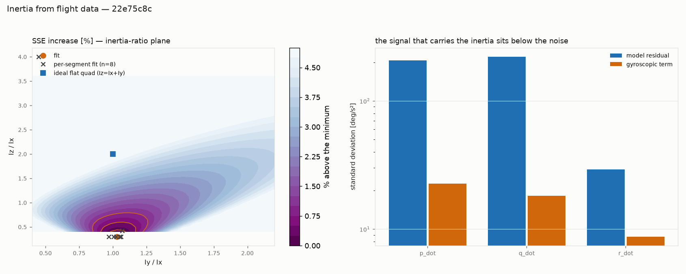
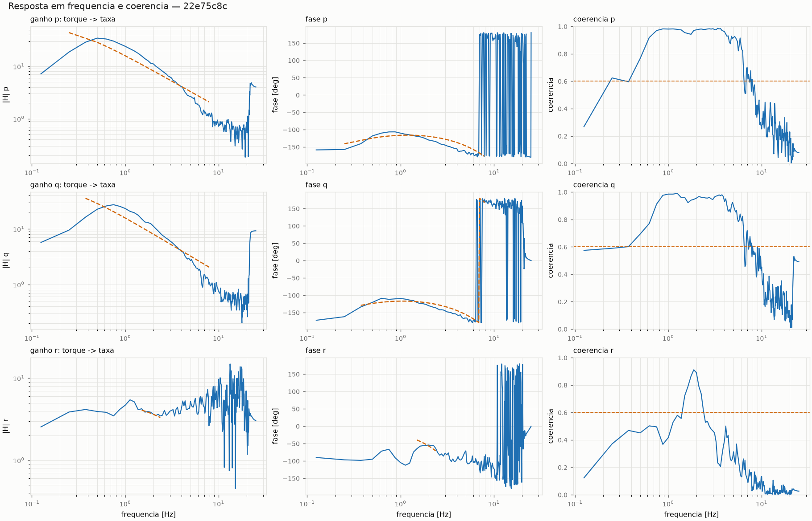
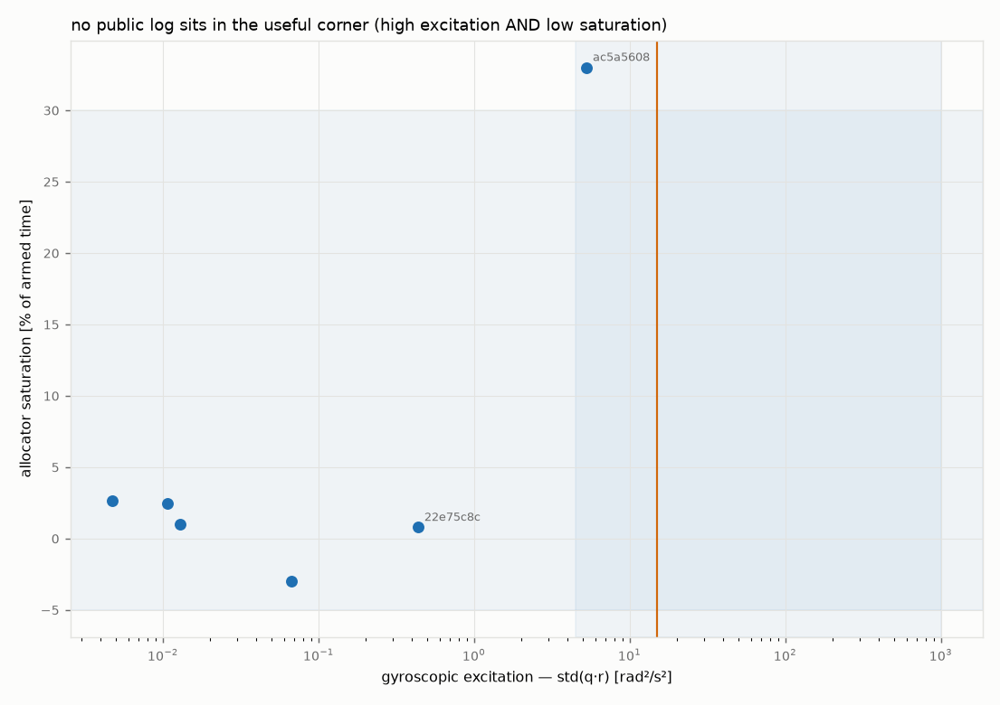

# You cannot measure your drone's inertia from the logs you already have

Every multirotor flight log contains, in principle, the vehicle's moments of inertia.
The rigid-body equations say so:

```
Ix·ṗ = (Iy − Iz)·q·r + τx
Iy·q̇ = (Iz − Ix)·p·r + τy
Iz·ṙ = (Ix − Iy)·p·q + τz
```

Rates and commanded torques are both logged. The inertia ratios sit in front of the
products `q·r`, `p·r` and `p·q`. Fit the equations, read off the coefficients, done —
no bifilar pendulum, no CAD model, no scale. A free measurement from data you already
have.

I spent several days trying to collect it, on public PX4 logs, with five different
methods. It does not work, and the interesting part is *why* it does not work, because
the reason is not the one I expected.

Everything below is reproducible on public logs from
[PX4 Flight Review](https://review.px4.io).

---

## Attempt 1: sparse regression, straight at it

Start with the obvious: build a library of candidate terms, regress the measured
angular accelerations on it, and let sparse regression (SINDy, sequential thresholded
least squares) keep the terms that matter.

Log `22e75c8c`: a quadrotor on PX4 v1.17 with 240 s of usable manual flying, rates to
±250 °/s. Input from `vehicle_torque_setpoint`, grid at 50 Hz, derivative by
Savitzky-Golay.

The first fits were mediocre until two terms went in, and both are physics rather than
curve-fitting:

1. **A first-order lag on the command.** Sweeping the time constant: 0 ms gives a mean
   test R² of 0.65, **60 ms gives 0.76**, 200 ms drops back to 0.67. That is the motor
   and ESC.
2. **`tau·T` terms** — control effectiveness grows with thrust, because a more loaded
   rotor delivers more differential torque per unit of command.

With both, on held-out data:

| axis | test R² | terms |
|---|---|---|
| `p_dot` | **0.924** | **3** |
| `q_dot` | 0.896 | 7 |
| `r_dot` | 0.428 | 11 |

Roll comes out as a three-term equation. That is a good model.

And the gyroscopic terms? **Zeroed.** The regression threw away `q·r` and `p·r`
entirely. The coefficients I came for were the ones the method decided were not worth
keeping.

---

## Attempt 2: force the physics in

Maybe the free library was too permissive. So constrain it: write only physically
admissible terms, and couple the three equations through a single pair of ratios
`ky = Iy/Ix`, `kz = Iz/Ix`, with control effectiveness and damping forced positive.
Given `(ky, kz)` everything else is linear, so the whole cost surface can be swept.



Four independent results, all pointing the same way:

**The optimum is physically impossible.** It lands at `Iz/Ix = 0.30`. A flat quadrotor
has `Iz ≈ Ix + Iy`, so `Iz/Ix ≈ 2`; a ratio of 0.3 describes a body elongated along the
vertical axis, which is not a quadcopter. And forcing the correct value costs only
**+5.7 % of the residual sum of squares** — the data barely objects.

**The estimate does not repeat.** Fitting eight segments of the same flight
independently, `Iz/Ix` pins to the lower bound in six of them and to the upper bound in
one. With `kz` fixed at the correct value and only `ky` free, the best `Iy/Ix` wanders
from 0.5 to 2.0 between segments, and in three of six the band within 1 % of the
minimum covers the entire swept range.

**The signal is under the noise.** The gyroscopic term contributes 22, 18 and 9 °/s²
on the three axes, against residuals of 207, 221 and 29 °/s². That is the right-hand
panel of the figure: a decade of difference.

**The decisive test.** Put in the *correct* inertia (`ky=1, kz=2`) and compare against
having no gyroscopic term at all:

| axis | with term | without term | gain |
|---|---|---|---|
| `p_dot` | 0.8664 | 0.8708 | −0.004 |
| `q_dot` | 0.7012 | 0.7217 | **−0.021** |
| `r_dot` | 0.0559 | 0.0559 | 0.000 |

The physically correct term makes the prediction *worse*. Whatever the regression was
finding at `Iz/Ix = 0.30`, it was `q·r` acting as a proxy for unmodelled dynamics, not
a measurement of inertia.

At this point the honest conclusion is "not identifiable". But that conclusion rested
on one method, with one known weakness — a numerical derivative — and no treatment of
the fact that flight data is closed-loop. Three standard methods exist for exactly
those two problems, and I had not tried any of them.

---

## Attempt 3: weak form, no derivative at all

Differentiating noisy data amplifies the noise. The standard fix is the weak
formulation: multiply the equation by a compactly supported test function φ and
integrate by parts, so

```
∫ φ · ẋ dt  =  −∫ φ′ · x dt
```

The left side, which needed the derivative, becomes an integral of the signal itself.
No numerical differentiation enters the regression anywhere.

Result, with the same model-selection rule as before (fewest terms within 3 % of the
best test R²): **0.902 / 0.848 / 0.309**, against **0.924 / 0.896 / 0.428** for the
strong form. Equivalent — slightly worse, in fact. `Iz/Ix` still pins to the lower bound and still ranges
0.30–4.00 across segments.

One thing did change, and it sharpens the conclusion. The decisive test moves from
**harmful** (−0.021 on pitch) to **indifferent** (+0.002, +0.0006, 0.0000). Without
derivative noise the gyroscopic term is no longer actively damaging the fit. It simply
carries **no information**. That is a cleaner statement of non-identifiability than the
one I had.

It also killed a result I had almost reported. The joint fit gave `Iy/Ix = 1.01 ± 0.08`
across segments, which looks like a real measurement of a symmetric quad. Fixing `kz`
at 2 and sweeping `ky` alone shows it is not: the optimum ranges 0.6 to 2.0. The tight
number was an artefact of the parameterisation, with one rail pinned and the other
compensating.

---

## Attempt 4: instrumental variables for the closed loop

The deeper problem is that an operational log is not an open-loop experiment. The
command is produced by the controller from the state — roughly `u = −K·x` — so
regressors and residual are correlated and every coefficient is biased. This is what
produced *positive* (non-physical) damping in the earlier fits.

The classic remedy is an instrument: a signal that enters the system from outside and is
not computed from the estimated state. Here that is the pilot's stick,
`manual_control_setpoint`, used in two-stage least squares.

I expected the instrument to be too weak to help: it is logged at only 4.9 Hz on this
vehicle. It is not. The first-stage R² is **0.73 for τx, 0.75 for τy, 0.95 for thrust** —
a strong instrument. Only yaw torque is weak (0.27), which makes sense since yaw was
barely commanded.

What the correction buys:

| | OLS | 2SLS |
|---|---|---|
| damping, roll | −0.64 1/s | −0.51 1/s |
| `b0` (τ) | 111 | 342 |
| `b1` (τ·T) | 85 | −367 |
| **effective gain `b0 + b1·T̄`** | **152** | **164** |

The non-physical damping survives, 21 % smaller. The individual coefficients swing
wildly — but that is the two columns `τ` and `τ·T` being nearly collinear, and their
*combination* at typical thrust is stable to 7 %. So the closed-loop correction does not
rescue the inertia or the damping; it does confirm that the effective control gain is
real.

---

## Attempt 5: the frequency domain, which finally explains it

In the frequency domain differentiation is a multiplication by jω, so the derivative
problem disappears. And you get something no time-domain metric gives you: **coherence**,
which tells you in which band the data can be trusted at all.



**Coherence is 0.99 between 0.25 and 8 Hz** on roll and pitch. In that band the
torque-to-rate relationship is excellent. This is the single most useful number in the
whole investigation, and nothing I had computed before was telling me about it.

Look at the gain plot, left column. The measured `|H|` **peaks around 0.5–0.75 Hz and
falls off below that.** A plant does not do that. A closed loop does: below its
bandwidth the controller suppresses error, so the apparent plant response collapses.
That is the closed-loop contamination, drawn.

Then the part that resolved a mystery I had been carrying since attempt 1. Fitting a
first-order model with a free pole gives negative damping — in every band I tried,
getting *more* negative at higher frequencies, so it is not a low-frequency artefact.
Comparing structures instead, weighted by coherence, on the roll axis:

| structure | parameters | R² |
|---|---|---|
| `K·e^{−s·td}/(s+a)`, free pole | a = −0.91 1/s, td = 40 ms | 0.869 |
| `K/(s(1+s·Tm))` integrator + motor | Tm = 60 ms, K = 144 | 0.921 |
| `K·e^{−s·td}/s` pure integrator | td = 50 ms, K = 129 | 0.916 |
| `K·e^{−s·td}/(s(1+s·Tm))` | Tm = 40 ms, td = 20 ms, K = 138 | **0.937** |

**The negative damping was never bias. It was the wrong model structure.** Roll is a
pure integrator plus about 60 ms of actuator lag, with no aerodynamic damping that this
data can resolve — which is exactly what physics predicts for a small multirotor at
these rates. Fitting a first-order model forces a pole where there is none, and the
only way to absorb the extra phase is to put that pole in the right half plane.

Three independent estimators had agreed on an unphysical number, and all three were
answering a badly posed question.

---

## So go find a log with more excitation

The gyroscopic term needs large products of rates. On this flight `std(q·r)` is 0.54
rad²/s²; for the term to clear the residual by 3× it would have to be about **27×
larger**. So: find a better log.

I searched all **493,010 flights** in the public PX4 database.

First finding, and a warning for anyone building log tooling: **the flight-mode label
does not predict excitation.** The logs with the most time in "Acro" — coaxial octos and
industrial hexas, 800 to 2400 s of it — have a roll-rate standard deviation of 3 to
7 °/s. They sit still in that mode. The most excited log in my first batch was flown in
*Manual*.

Filtering by airframe instead (250-class racers, FPV frames) found one real candidate:
a HolyBro QAV250, 49 s armed in Acro, hitting **q = 714 °/s with r = −483 °/s
simultaneously**. `std(q·r) = 5.26` — twelve times better than anything else I had, and
the only log in the set with non-zero time where both |q| and |r| exceed 100 °/s.

On that flight the gyroscopic term finally clears the noise: it contributes 174 °/s²
against a residual of 122 °/s².

And the model collapses completely. Test R² of **0.06 / 0.03 / 0.02** with the physical
library, negative without it, residuals of 500–900 °/s².

Why: 33 % of the armed time has at least one motor on the floor or the ceiling, so the
allocator cannot deliver the commanded torque and the model's input is fiction for a
third of the flight. Resampling from the raw 220 Hz gyro instead of the 48 Hz logged
rate makes it *worse*, so this is not aliasing — it is a rigid-body-plus-first-order-lag
model being asked to describe a 250 mm quad at 700 °/s, where blade flapping, prop wash
and asymmetric induced drag are not small.



**The two requirements fight each other.** Seeing the gyroscopic term requires violent
manoeuvring; violent manoeuvring saturates the allocator and leaves the regime where the
model is valid. Across 33 downloaded logs, the useful corner — high excitation *and* low
saturation — is empty. Not because I did not look hard enough, but because nobody flies
that way by accident.

---

## What the data will actually give you

Not inertia. But the same analysis hands over three things that are solid:

- **Control effectiveness.** Roughly 140–165 rad/s² per unit of normalised roll torque:
  138–144 from the frequency domain once the model structure is right, 152 from ordinary
  least squares in the time domain, 164 from the instrumental-variable estimate. Three
  methods inside a ±10 % band. It roughly doubles between unloaded and full thrust, which
  has a direct consequence: a rate gain tuned in hover is under-damped in hard
  manoeuvring.
- **Actuation delay**, 30 to 60 ms depending on method — the lag a rate controller has to
  compensate.
- **The coherent bandwidth**, 0.25 to 8 Hz here, which is the honest statement of where
  this log can support any conclusion at all.

And a specification, if you do want the inertia. You need coordinated roll/pitch **and**
yaw rates at the same time, deliberate allocator margin so no motor reaches its floor,
and the gyro logged at high rate. Three conditions simultaneously. That is a designed
test, not a log you happen to have.

---

## The claim, stated carefully

Not: "inertia cannot be identified from operational logs."

But: *the inertia ratios cannot be identified from these operational logs by
time-domain sparse regression, nor in weak form, nor with instrumental variables — and
the frequency response shows why. Below about 0.5 Hz the closed loop dominates the
measured response, and above it the gyroscopic term sits under the residual.*

The difference between those two sentences is four methods. The first version is a
guess dressed as a conclusion; the second is a result. Publishing the first would have
been faster and would have been wrong in a way that someone with system-identification
experience spots immediately.

The part worth keeping is not that the measurement failed. It is that the investigation
produced a structure — integrator plus 60 ms lag, thrust-dependent gain, no resolvable
aerodynamic damping — that I can defend, and a quantified statement of what a log would
need to contain before it could answer the original question.

---

*I build tooling that turns PX4 and ArduPilot logs into this kind of answer, including
when the answer is "your data cannot support that conclusion, and here is what it would
take". If you fly these vehicles and have a question you have been trying to get out of
your logs, send me one and I will take a look.*

*— Rodolfo Noleto, aeronautical engineer. [nolforge.com](https://nolforge.com)*
