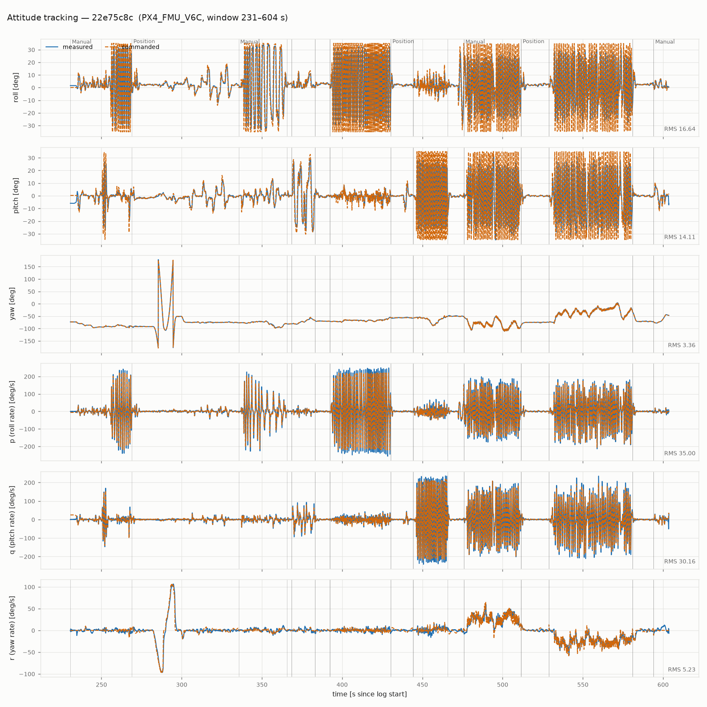
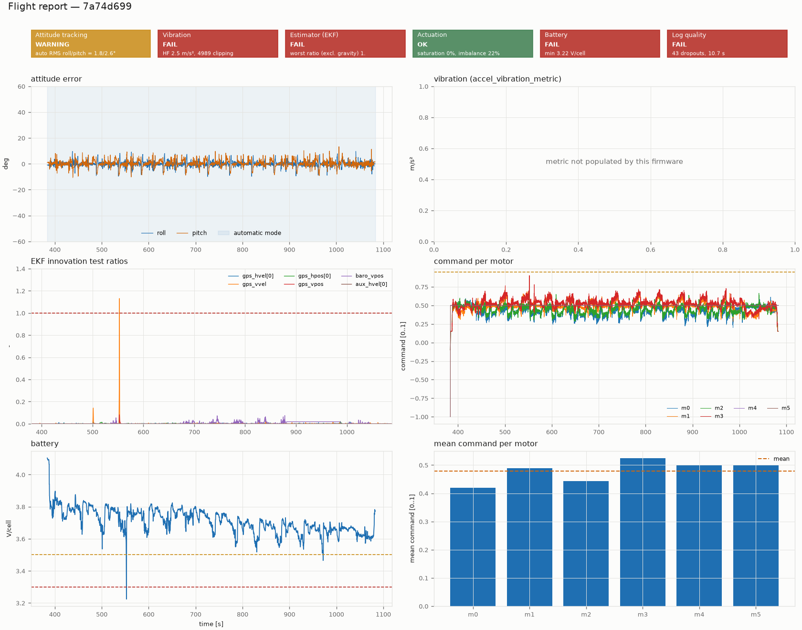
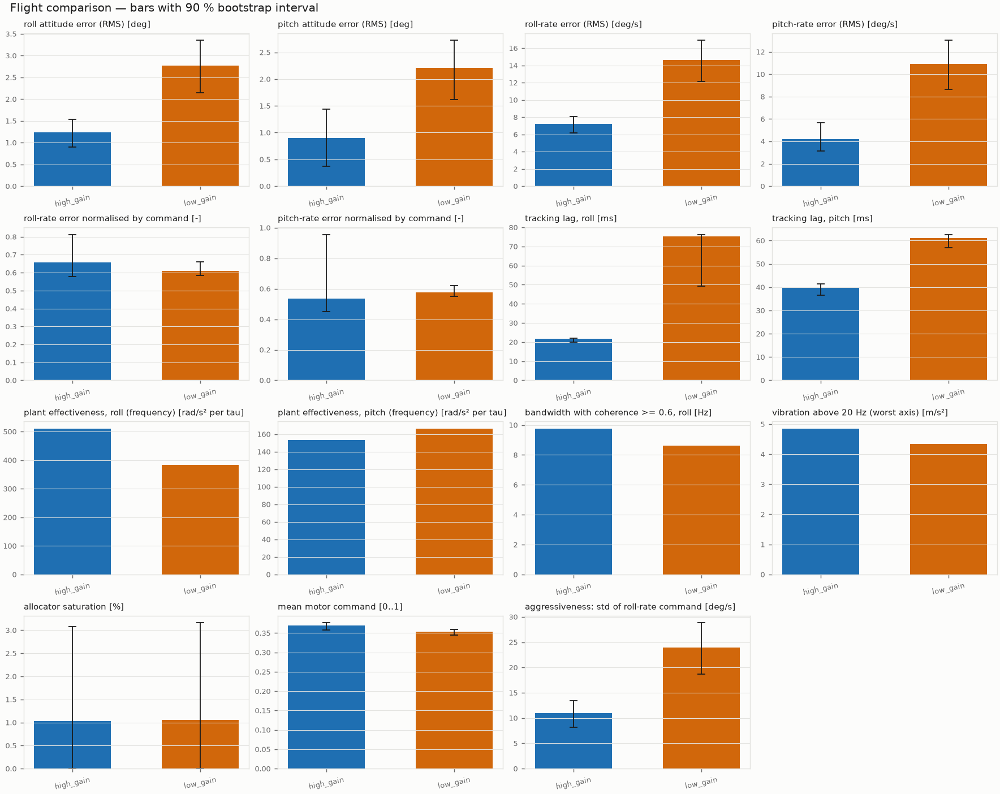

# Five flight-log metrics that lie — and what to use instead

A quadrotor tracks attitude to 20.7° RMS. That sounds broken.

The same quadrotor, the same flight, four minutes later, tracks to 2.3°. Nothing was
repaired in between. Nobody touched a gain. The vehicle did not land.

The difference is that the first number was measured in Manual mode and the second in
Position mode, and in Manual the attitude setpoint is whatever the pilot's stick says
it is — a step input that no airframe can follow. The 20.7° is not a defect. It is the
metric answering a question nobody asked.

I spent a few days running system identification and health checks over public PX4
logs, and most of the time I was not fighting the data. I was fighting metrics that
look authoritative and are quietly measuring the wrong thing. Here are five, each with
the number that exposed it, and what I use instead.

All numbers come from public logs on [PX4 Flight Review](https://review.px4.io), and
every check described here is reproducible.

---

## 1. Attitude tracking RMS, measured in a piloted mode



Same flight, split by mode:

| | roll RMS | pitch RMS | roll-rate RMS | pitch-rate RMS |
|---|---|---|---|---|
| automatic modes (133 s) | 2.3° | 1.5° | 4.0 °/s | 5.1 °/s |
| piloted modes (240 s) | 20.7° | 17.5° | 43.5 °/s | 37.4 °/s |

A factor of nine on the same airframe with the same tuning.

In Position, Mission or Hold, PX4 generates the attitude setpoint itself, smoothly, and
tracking error is a genuine quality measure. In Manual, Stabilized or Acro the setpoint
is the stick: it steps 40° in one sample and the aircraft needs a few hundred
milliseconds to get there. Large error is the correct behaviour of a correctly tuned
aircraft.

**Use instead:** compute tracking error only in automatic modes, and report the piloted
segments separately as information. If you have to compare piloted flights, compare
error normalised by commanded rate, not raw error — see trap 4.

---

## 2. EKF innovation ratios, with gravity included

An innovation test ratio above 1 means the estimator rejected that measurement. It is a
good alarm, and it is tempting to take the worst one in the flight as a health score.

On a perfectly normal quadrotor flight, that worst one was:

```
gravity[1]: median 0.07, peak 8.74, above 1 for 22.8% of the flight
```

Fail the flight on that, and you have just failed a healthy aircraft. EKF2 fuses the
accelerometer as a gravity reference, and that reference is only valid when the vehicle
is not accelerating. Under manoeuvring it is *supposed* to be rejected. The rejection
is the filter working, not failing.

Exclude gravity from the same flight and the worst remaining ratio is **0.45** — below
the rejection threshold, everywhere, all flight.

**Use instead:** treat gravity innovations as informational. Score the flight on GPS
position and velocity, barometer, magnetometer and heading innovations, plus
`filter_fault_flags` and the EKF reset counters, which are unambiguous. On one log in my
sample those counters showed 12 vertical-velocity resets and a non-zero fault flag in
119 samples — that one deserved the alarm, and the ratios alone would not have raised
it.

---

## 3. A vibration metric that reads zero



An 18-minute hexarotor flight reported:

```
IMU 0: accel_vibration_metric  median 0.0, peak 0.1 m/s²
IMU 1: accel_vibration_metric  median 0.0, peak 0.1 m/s²
```

Spotless. Except the accelerometer clipping counters on the same flight increased by
**4,989 events** — 2,812 on IMU 0, 2,162 on IMU 1. Clipping means the accelerometer hit
its measurement range and the sample is garbage. That is the opposite of spotless.

The firmware on that vehicle (a v1.24 vendor fork) simply does not populate
`accel_vibration_metric`. The field exists in the message definition, so it reads as a
valid zero rather than as missing data.

**Use instead:** never let a zero stand for "no data". Check whether the metric varies
at all across the flight; if it does not, say "not populated by this firmware" and fall
back on measurements you computed yourself — the high-pass RMS of the raw accelerometer
above 20 Hz — plus the clipping counters, which are integers that only ever increase and
cannot be faked by a missing field.

---

## 4. Comparing raw RMS between two flights



This is the one that would have cost me a wrong engineering conclusion.

I found two flights of the same airframe, same day, same `sys_uuid`, where
`MC_ROLLRATE_P` went from 0.11 to 0.05 — a controller gain cut in half. A clean before
and after. The raw numbers:

| metric | high gain | low gain |
|---|---|---|
| roll-rate error RMS | 7.2 °/s | **14.6 °/s** |
| pitch-rate error RMS | 4.2 °/s | **10.9 °/s** |

Error doubled. Case closed: halving the gain made tracking twice as bad.

Except the same comparison also reports this:

| metric | high gain | low gain |
|---|---|---|
| commanded roll-rate std (how hard it was flown) | 11.0 °/s | **23.9 °/s** |
| **error normalised by command** | 0.66 | **0.61** (unchanged) |

The second flight was flown twice as hard. Error per unit of demand did not change at
all — the difference sits inside the confidence interval. The raw RMS doubled because
the pilot doubled the demand, and it would have doubled with no gain change whatsoever.

So did halving the gain do nothing? No. One metric moved cleanly:

| metric | high gain | low gain | difference (90% CI) |
|---|---|---|---|
| tracking lag, roll | 21.8 ms | 75.4 ms | **+53.6 ms [+28, +54]** |

Tracking lag — the delay that maximises cross-correlation between commanded and
measured rate — does not scale with how hard you fly. It is a property of the loop. The
loop got 54 ms slower, which is exactly what control theory predicts from halving a
proportional gain.

The raw RMS would have given the right verdict for the wrong reason. Reverse the
situation — make the *high* gain flight the aggressive one — and it gives the wrong
verdict outright.

**Use instead:** split your comparison metrics into two lists and label them.
*Condition-sensitive*: raw RMS, saturation percentage — these move with wind, payload
and pilot. *Robust*: error normalised by command, tracking lag, and plant properties
measured in the frequency domain — these do not. Report an aggressiveness indicator
alongside, and warn the reader when it changed. And put confidence intervals on
everything: I use a block bootstrap over 10 s segments, which is cheap and makes "this
difference is noise" a statement you can check rather than a feeling.

One more guard that comes free: if the mean motor command differs by more than ~5 %
between the two flights, they are not the same aircraft in the same condition. That is
weight, battery health or propulsion, and no performance difference should be blamed on
configuration until that is explained.

---

## 5. Normalising by a command that is almost zero

Trap 4 says to normalise error by commanded rate. Trap 5 is what happens when you do it
carelessly.

I validated my own comparison tool by splitting a single flight in half and comparing
the halves against each other. Same aircraft, same tuning, same day, same battery — the
honest answer is "no significant difference". The tool agreed on every raw metric, and
then flagged one:

```
normalised pitch-rate error: +0.68, significant
```

There was no difference. One half of the flight simply had very little pitch command,
and dividing a normal error by a near-zero denominator produces a large number with a
confident-looking confidence interval around it.

**Use instead:** refuse to compute a normalised metric below a floor of excitation. I
require `std(command) ≥ 3 °/s` and return "not measurable" otherwise. The same logic
applies to tracking lag: if the peak cross-correlation is below 0.5, there is no lag to
report, only the point where noise happened to line up best. Without that guard the lag
metric cheerfully reported 265 ms on a vibrating airframe.

---

## The bonus trap: trusting metrics you only tested on good logs

I built all of the above against six logs I had chosen by hand. Then I ran the same
code over **209 public flights**, one per vehicle, to turn my invented thresholds into
fleet percentiles.

Three of my own metrics broke immediately:

| metric | 99th percentile across the fleet | what was actually happening |
|---|---|---|
| worst EKF innovation ratio | 6.3 × 10¹² | ratios from an uninitialised filter — numeric garbage, not a large innovation |
| minimum cell voltage | 47.9 V/cell (and a 10th percentile of 0.025) | `cell_count` reported as zero or wrong, and I divided by it without checking |
| motor imbalance | 6.1 × 10⁶ % | division by a near-zero mean command with the aircraft on the ground |

None of these appear in six hand-picked logs. All three appear within minutes in 209
random ones. If you have written log-analysis code and only ever run it on flights you
chose, you have some of these waiting for you.

The fix in each case was a plausibility gate: discard innovation ratios above 10³ and
report "filter diverged or not initialised"; validate cell voltage against the physical
2.5–4.35 V window and *infer* the cell count when the field is wrong; require a
meaningful mean thrust before computing an imbalance ratio.

And the calibration gave something better than thresholds. Instead of "FAIL, clipping
above 1000", every flight now gets its position in the measured distribution:

```
accelerometer clipping   4989    96th percentile (n = 208)
dropouts                 10.7 s  97th percentile (n = 209)
allocator saturation     0.04%    2nd percentile (n = 201)
```

That is checkable, and it does not depend on me having guessed the right cut. Where I
did keep my own cut, it is for a stated reason: an innovation ratio above 1 means the
measurement was rejected, and the fleet being worse does not make rejection acceptable.

---

## The pattern

Every one of these traps has the same shape. The metric is computed correctly. The
arithmetic is right. What is wrong is the implied question: *compared to what, under
what conditions, and is this quantity even defined here?*

Flight logs make that easy to forget, because they hand you thousands of numbers that
all look equally solid. A metric that silently returns nonsense is worse than no metric,
because you will act on it.

Three habits that catch most of it:

1. **Condition on flight mode** before computing anything about tracking.
2. **Separate what scales with how hard the aircraft was flown** from what does not, and
   say which is which in the output.
3. **Run your checks over a few hundred flights you did not choose** before you trust a
   single one.

---

*The toolkit I used — per-flight reports with fleet-calibrated thresholds,
flight-to-flight comparison with confidence intervals, and attitude-rate system
identification in both time and frequency domain — is on GitHub. If you fly PX4 or
ArduPilot and want a second pair of eyes on a log, I am happy to run it and send you
what it finds.*

*— Rodolfo Noleto, aeronautical engineer. [nolforge.com](https://nolforge.com)*
